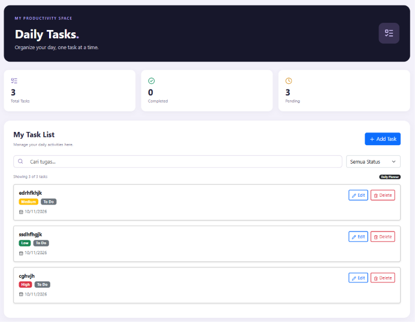
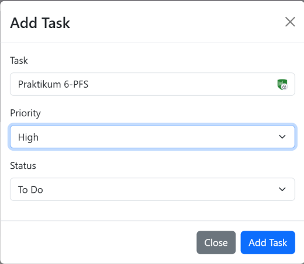
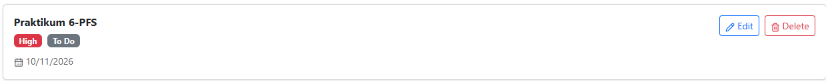
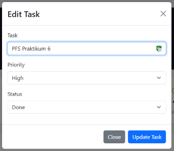
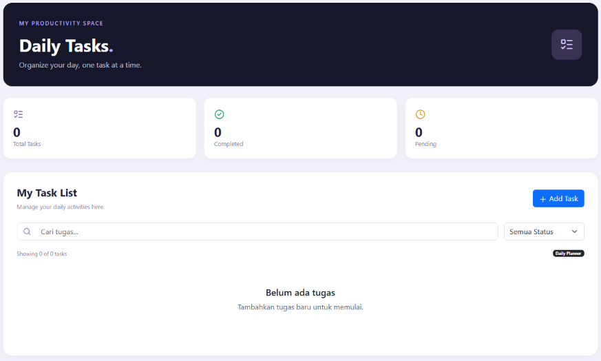

# TodoList React JS CRUD
Aplikasi TodoList sederhana yang dibuat menggunakan React JS untuk membantu mengelola daftar tugas sehari-hari.

## Fitur Aplikasi

- Create    : Menambahkan tugas baru melalui tombol Add Task.
- Read      : Menampilkan daftar tugas yang sudah dibuat.
- Update    : Mengubah informasi tugas melalui tombol Edit.
- Delete    : Menghapus tugas melalui tombol Delete.
- Search    : Mencari tugas berdasarkan nama.
- Filter    : Menyaring tugas berdasarkan status pengerjaan.
- Statistik : Menampilkan jumlah seluruh tugas, tugas yang sudah selesai, dan tugas yang belum selesai.
- Informasi Tugas   : Menampilkan nama tugas, prioritas, dan status pengerjaan.

## Teknologi yang Digunakan
- React JS
- Vite
- React Bootstrap
- Lucide React

## Screenshot Aplikasi
### 1. Dashboard

### 2. Tambah Tugas

### 3. Daftar Tugas

### 4. Edit Tugas

### 5. Hapus Tugas

## Cara Menjalankan Aplikasi
1. Clone repository GitHub.
2. Jalankan `npm install`.
3. Jalankan `npm run dev`.
4. Buka alamat localhost yang muncul di terminal.
