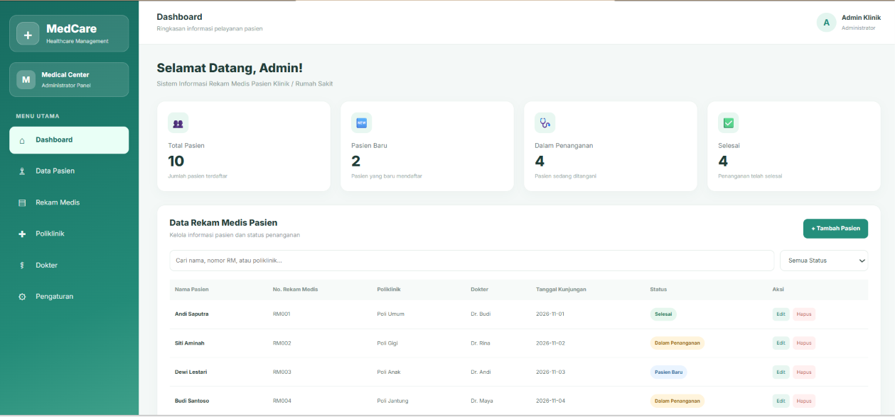
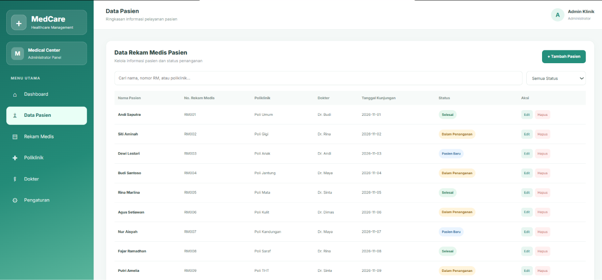
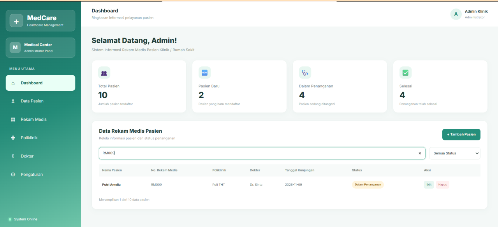
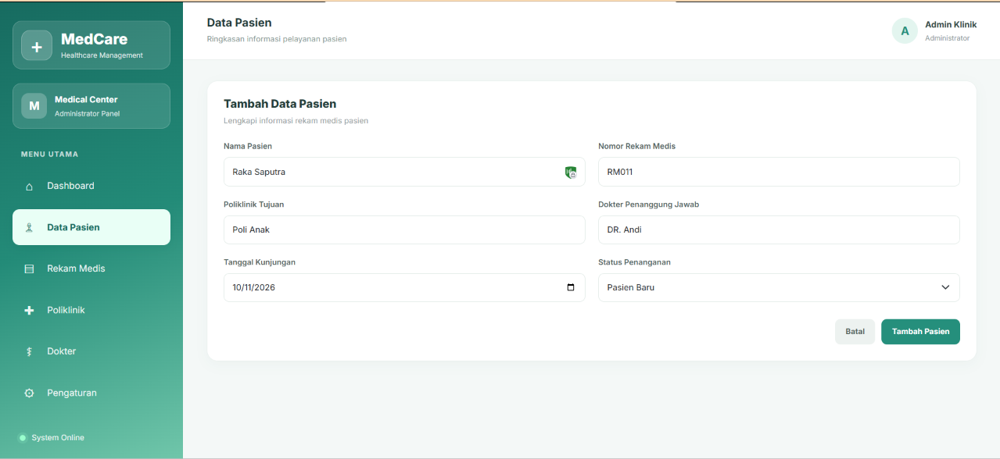
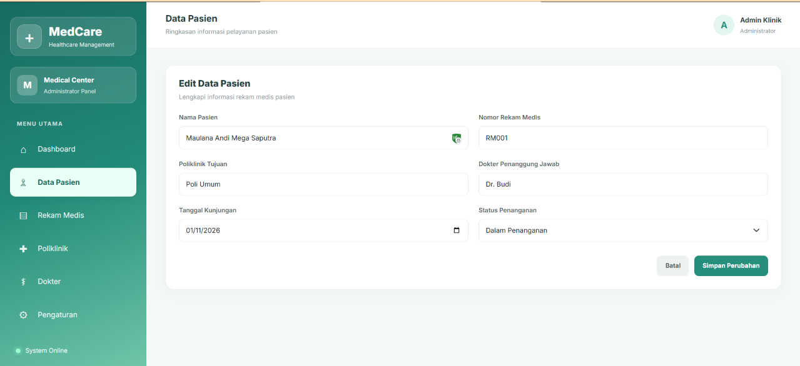
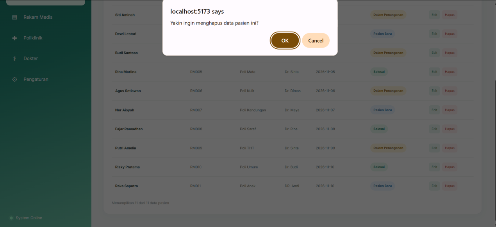
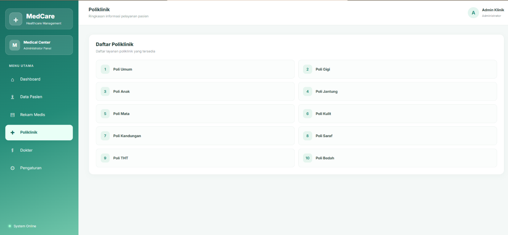
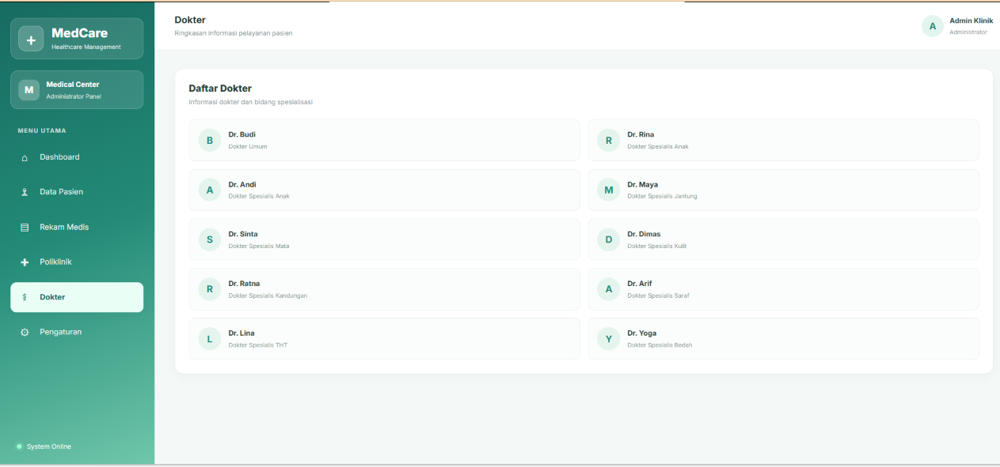
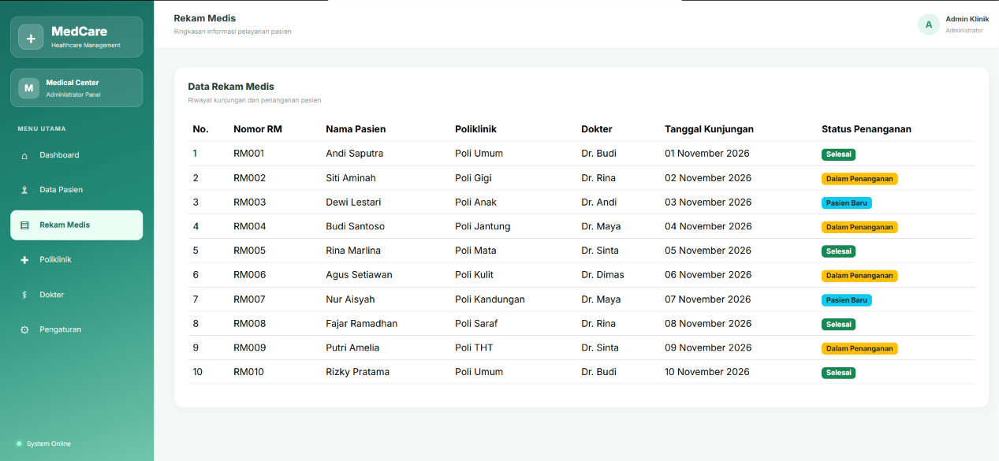
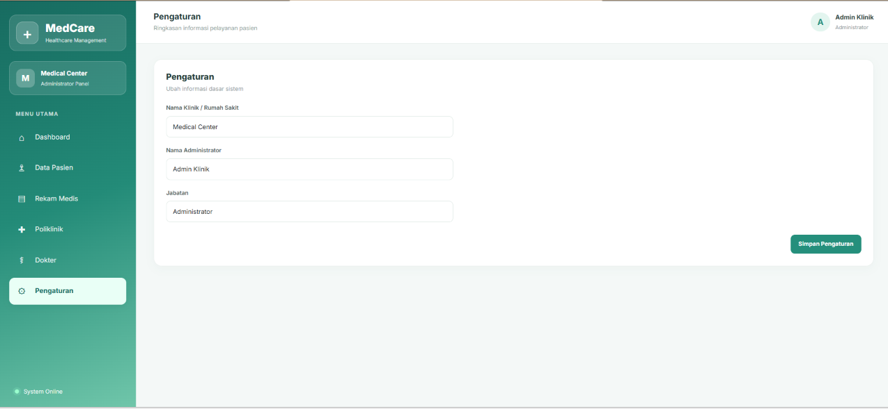

# Dashboard Rekam Medis Klinik

Aplikasi Dashboard Rekam Medis Klinik berbasis React JS yang dibuat untuk membantu pengelolaan data pasien dan informasi rekam medis secara sederhana.

## Fitur Aplikasi

- **Dashboard:** Menampilkan ringkasan statistik dan informasi pasien.
- **Data Pasien:** Menampilkan daftar data pasien.
- **Create:** Menambahkan data pasien baru.
- **Read:** Menampilkan informasi pasien dan rekam medis.
- **Update:** Mengubah informasi data pasien.
- **Delete:** Menghapus data pasien.
- **Search:** Mencari data pasien berdasarkan kata kunci.
- **Poliklinik:** Menampilkan informasi poliklinik.
- **Dokter:** Menampilkan informasi dokter.
- **Rekam Medis:** Menampilkan informasi riwayat kunjungan pasien.
- **Status Penanganan:** Menampilkan status penanganan pasien.
- **Pengaturan:** Mengelola informasi profil aplikasi.

## Teknologi yang Digunakan

- React JS
- Vite
- JavaScript
- Bootstrap
- CSS

## Screenshot Aplikasi

### 1. Dashboard

### 2. Data Pasien

### 3. Pencarian Pasien

### 4. Tambah Pasien

### 5. Edit Pasien

### 6. Hapus Pasien

### 7. Poliklinik

### 8. Dokter

### 9. Rekam Medis

### 10. Pengaturan

## Cara Menjalankan Aplikasi

1. Clone repository GitHub.
2. Jalankan `npm install`.
3. Jalankan `npm run dev`.
4. Buka alamat localhost yang muncul di terminal.
